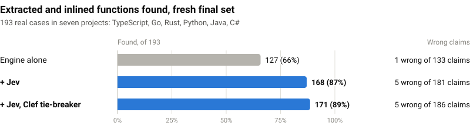
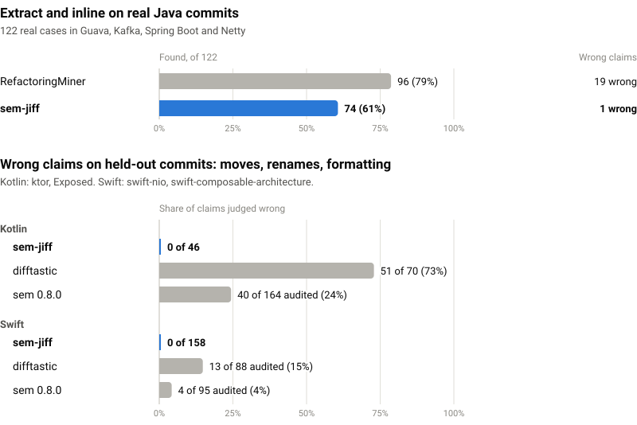

# @plannotator/sem-jiff

Part of Plannotator, try [Plannotator Inbox](https://github.com/backnotprop/plannotator); an inbox to stay in the loop and organize better code review.

A diff shows lines that were added and deleted. Much of that is not a real change: a function moved,
a variable renamed, code reformatted, a block pulled out into a helper. sem-jiff reads both versions of a
file and says what each change really is, so a reviewer can skip what kept its meaning. It returns plain
data (`semanticOperations`, `semanticFolds` and the matching patch) that any diff viewer can draw.
The operation types in `src/pierre-types.ts` are copied from
[Pierre](https://github.com/pierrecomputer/pierre) (Apache-2.0).

Example, rendered in Plannotator:<br/>


## What it finds

| Change | Example |
|---|---|
| Moved | `loadUser` moved below `saveUser`, unchanged |
| Moved and edited | moved, with a line changed on the way |
| Renamed | `MAX_RETRIES` became `MAX_ATTEMPTS` everywhere, nothing else changed |
| Reformatted | the same code laid out differently (line breaks, Prettier) |
| Reordered | imports or members re-sorted |
| Extracted function | a loop left `checkout` and now lives in a new `sumLineItems` it calls |
| Inlined function | a helper was removed and its body pasted where it was called |
| Added, deleted, edited | everything else, as a plain diff |

It prefers saying nothing to saying something wrong: a missed change falls back to
the plain diff, while a wrong label would mislead the reviewer.

## Install

```sh
npm install @plannotator/sem-jiff
```

## Usage

```ts
import { semanticDiffFile, languageForPath } from '@plannotator/sem-jiff';

const language = languageForPath('src/users.ts'); // 'typescript'
const { semanticOperations, semanticFolds, patch } =
  await semanticDiffFile(language, oldText, newText, 'src/users.ts');

// Give your diff viewer the patch too, so its layout matches the operations,
// then draw semanticOperations over it.
```

In Node nothing else is needed. In a browser, copy the grammars next to your app
(`npx sem-jiff-copy-wasm <dir>`) and tell the engine where they are served from with
`configure({ locateGrammar, locateRuntime })`. Options, `reviewSummary` and browser setup: [docs/usage.md](docs/usage.md).

## Power Up: Jev and Clef

The rules are strict, so they miss extracted functions whose code was reworded on the way out.
Give the engine a second opinion and it asks about exactly those candidates, once per file:
Jev (via TypeSafe) decides, and Clef (Cloudflare) breaks the tie when Jev is unsure.
Your key, your account; call it from a server or your own machine.

<picture>
  <source media="(prefers-color-scheme: dark)" srcset="docs/assets/power-up-flow-dark.svg">
  
</picture>

```ts
import { jevOpinion, clefScore } from '@plannotator/sem-jiff/opinions';

const secondOpinion = jevOpinion({ apiKey, tieBreaker: { ask: clefScore({ accountId, apiToken }) } });
const diff = await semanticDiffFile('typescript', oldText, newText, 'src/cart.ts', { secondOpinion });
```

<picture>
  <source media="(prefers-color-scheme: dark)" srcset="docs/assets/power-up-dark.svg">
  
</picture>

About $0.0004 per 500-line change with Jev. Answers are remembered, so opening the same diff again
costs nothing. More in [docs/usage.md](docs/usage.md#second-opinion-power-up).

## How it compares

<picture>
  <source media="(prefers-color-scheme: dark)" srcset="docs/assets/compare-dark.svg">
  
</picture>

On TypeScript practice commits (187 real cases): RefactoringMiner 73 found, 14 wrong; sem-jiff 105, 1 wrong;
with Jev 148, 1 wrong. Every comparison: [harness/compare/README.md](harness/compare/README.md).
How the engine is tested: [docs/verification.md](docs/verification.md).

## Languages

TypeScript and TSX, JavaScript, Python, Go, Rust, Java, C#, PHP, Ruby, Kotlin and Swift.
What each one holds back in this version is in [CHANGELOG.md](CHANGELOG.md).

## More

- [docs/usage.md](docs/usage.md): options, `reviewSummary`, browser setup, second opinion, development commands
- [docs/verification.md](docs/verification.md): how it is verified, every result, the known erratum in Pierre's fixture
- [docs/history.md](docs/history.md): development milestones
- [docs/layout.md](docs/layout.md): source layout and how a language is added
- [PACKAGING.md](PACKAGING.md), [CHANGELOG.md](CHANGELOG.md)

## Licence

MIT or Apache-2.0, at your choice (`LICENSE-MIT`, `LICENSE-APACHE`), like Plannotator.
`src/pierre-types.ts` and the Pierre fixture are Apache-2.0, copied from
[Pierre](https://github.com/pierrecomputer/pierre).
The WebAssembly files in `wasm/` (web-tree-sitter and the grammars) keep their own licences: see
`THIRD-PARTY-NOTICES`.
